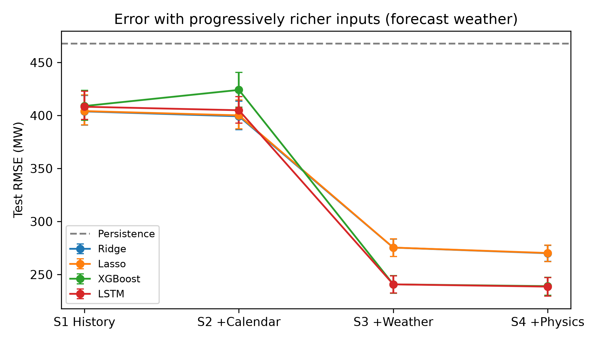
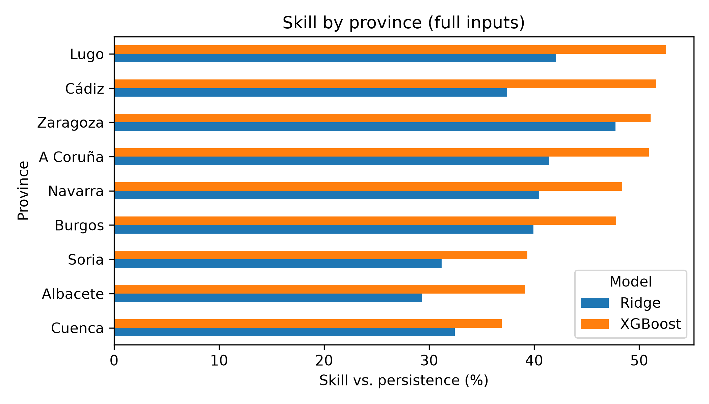

# Day-ahead wind power forecasting in Spain - Machine Learning - IE University

Forecasting hourly wind power generation (MW), 24 hours ahead, in the 9 Spanish provinces
with the highest wind output (about 60 % of mainland wind generation). The models use only
information that a forecaster would really have the day before: past generation, the calendar
and the **archived day-ahead weather forecast**.

## Contents

1. [Study design](#study-design)
2. [Data sources](#data-sources)
3. [Main results](#main-results)
4. [Project structure](#project-structure)
5. [Setup](#setup)
6. [Reproducing the study](#reproducing-the-study)
7. [Outputs](#outputs)
8. [Working in git](#working-in-git)
9. [Limitations and next steps](#limitations-and-next-steps)

## Study design

- **Period:** 2024-02-17 to 2026-06-30 (hourly, UTC). It starts in 2024 because Open-Meteo only
  archives day-ahead forecasts from that year. The period, the provinces and the weather variables
  live only in `src/config.py`.
- **Provinces:** Cádiz, Burgos, Navarra, Zaragoza, Lugo, A Coruña, Albacete, Soria and Cuenca.
  Weather is sampled at one point per province (its capital).
- **Split by time, never shuffled:** training until 2025-06-30, test from 2025-07-01 to 2026-06-30.
  The first training week is lost to the 168 h lag, so training effectively starts on 2024-02-24.
- **No data leakage:** the main experiment (`--weather forecast`) uses the weather forecast issued
  about one day before each hour. A second run (`--weather reanalysis`) uses the weather that
  actually happened and serves only as an upper bound ("perfect forecast").
- **Target:** each province's generation is divided by its maximum in the training data (a proxy for
  installed capacity). The models predict that 0-1 value and the result is scaled back to MW.

### Models

| Type | Models |
|---|---|
| Baselines | **Persistence** (generation 24 h earlier) and **Climatology** (training average by province, month and hour of day) |
| Linear | **Ridge** and **Lasso** |
| Trees | **XGBoost** (gradient-boosted trees; falls back to scikit-learn's `HistGradientBoostingRegressor` if xgboost is not installed) |
| Neural network | **LSTM** (PyTorch), reads the 24 h of inputs ending at the target hour |

Hyper-parameters are tuned with `GridSearchCV` on a 4-fold `TimeSeriesSplit` with a 48 h gap
between the training and validation blocks. The LSTM is tuned on the last 20 % of the training
period (hidden size 32 or 64, up to 20 epochs, early stopping), because training it many times is
too slow.

### Progressive input sets

Each set adds information to the previous one, to see which kind of information matters and
whether complex models extract more from it. Province indicators (one 0/1 column per province) are
included in every set.

| Set | Adds | Features |
|---|---|---|
| S1 History | Generation history: lags of 24, 48 and 168 h and a 24 h rolling mean, all at least 24 h old | 13 |
| S2 +Calendar | Hour of day and time of year (see `--calendar`) | 17 |
| S3 +Weather | Day-ahead forecast of 100 m wind speed and direction, gusts, temperature and pressure | 23 |
| S4 +Physics | Wind speed powers, an operating-range flag and 3 h changes in pressure and wind speed | 28 |

The feature counts are for the default `--calendar doy`.

### Evaluation

- **RMSE** and **MAE** in MW, **bias**, and **nRMSE** (RMSE as a % of the capacity proxy).
- **Skill (%)**: improvement of the RMSE over Persistence.
- **95 % confidence intervals** from a block bootstrap over test days (1000 resamples), which keeps
  the correlation within a day.
- **Model gaps:** `xgb_vs_ridge_gap.csv` and `lstm_vs_xgb_gap.csv` give the RMSE difference between
  two models, with its bootstrap interval.
- **Cost:** tuning time, fitting time and prediction time per model.

## Data sources

| Source | Data | Access |
|---|---|---|
| [ESIOS (REE)](https://api.esios.ree.es/) | Hourly wind generation by province (indicator 10037), MW | Requires an API token |
| [Open-Meteo Previous Runs API](https://open-meteo.com/en/docs/previous-runs-api) | Day-ahead weather forecast (`--weather forecast`) | Free, no key |
| [Open-Meteo Historical Weather API](https://open-meteo.com/en/docs/historical-weather-api) | ERA5-based observed weather (`--weather reanalysis`) | Free, no key |

Weather variables: wind speed and direction at 100 m, gusts at 10 m, temperature and pressure.
All timestamps are stored in UTC to avoid daylight saving time issues. Each final dataset has one
row per province and hour (about 187k rows).

## Main results

Test-set RMSE in MW with forecast weather (lower is better). Persistence: 467.7 MW.
Climatology: 453.4 MW.

| Set | Ridge | Lasso | XGBoost | LSTM |
|---|---|---|---|---|
| S1 History | 403.8 | 404.2 | 408.9 | 408.2 |
| S2 +Calendar | 399.2 | 400.1 | 424.1 | 404.9 |
| S3 +Weather | 275.4 | 275.4 | 240.7 | 240.7 |
| S4 +Physics | 270.0 | 270.3 | 239.0 | 238.6 |

Skill over Persistence (%) in the full set S4: Ridge 42.3, Lasso 42.2, XGBoost 48.9, LSTM 49.0.

1. **The weather forecast is the key input.** Going from S2 to S3 cuts the RMSE from 399-424 MW
   to 241-275 MW, and raises the skill over Persistence from 9-15 % to 41-49 %.
2. **Non-linear models only win once weather is included.** In S3 and S4, XGBoost beats Ridge by
   about 31-35 MW (95 % CI of the gap in S4: 25.8 to 35.7 MW). In S1 and S2 Ridge is better.
3. **XGBoost and the LSTM are equivalent with forecast weather.** Their gap in S3 and S4 is
   about 0 MW and its interval includes zero. With observed weather (reanalysis) the LSTM is
   ahead: in S4, 213.7 MW against 220.5 MW for XGBoost (gap of 6.7 MW, 95 % CI 3.1 to 10.6 MW).
4. **Forecast error has a cost.** In S4, using the forecast instead of the observed weather adds
   7.1 MW for Ridge, 18.5 MW (8.4 %) for XGBoost and 24.8 MW (11.6 %) for the LSTM.
5. **Adding the calendar hurts XGBoost** (S1 408.9 to S2 424.1 MW), while Ridge (403.8 to 399.2 MW)
   and the LSTM (408.2 to 404.9 MW) improve slightly. See the calendar experiment below.
6. **Provinces differ.** In S4, XGBoost's skill ranges from 52.8 % in Lugo to 37.1 % in Cuenca,
   the hardest province to forecast (also for the LSTM, with 35.5 %).

Reanalysis (perfect weather) results in S4: Ridge 263.0, Lasso 263.0, XGBoost 220.5 and LSTM
213.7 MW (skill 43.8 %, 43.8 %, 52.9 % and 54.3 %).




### Calendar experiment: does day of year make XGBoost overfit?

With about 16 months of training data, every day of the year appears roughly once, so a tree can
learn "the 15th of March had a lot of wind" instead of a pattern. We replaced the day-of-year
features in S2 with coarser ones, keeping the hour of day. This was run on CPU, so the XGBoost
numbers differ by a few MW from the tracked GPU results above.

| `--calendar` | Time-of-year features | XGBoost S2 (MW) | 95 % CI | Ridge S2 (MW) |
|---|---|---|---|---|
| (S1, no calendar) | none | 405.5 | 392.1 - 420.2 | 400.4 |
| `doy` | day of year (sin, cos) | 421.1 | 405.1 - 436.9 | 395.9 |
| `month` | month (sin, cos) | 407.8 | 393.6 - 422.2 | 395.9 |
| `season` | 4 season indicators | 403.6 | 389.6 - 418.6 | 397.7 |
| `none` | none (hour of day only) | 403.8 | 390.7 - 418.5 | 399.3 |

The XGBoost penalty appears with the finest date encoding and disappears with `season` or `none`,
which is consistent with date memorisation. The confidence intervals overlap because each is
computed per model, so a paired test on the same hours would be needed to confirm it. Full table:
`reports/results/calendar_ablation_summary.csv`.

## Project structure

```
data/                  # Not tracked by git: generated by the scripts below
  raw/esios/
  raw/open_meteo/
  processed/           # dataset_forecast.csv, dataset_reanalysis.csv
notebooks/             # EDA notebook, importing logic from src/
reports/
  figures/             # EDA figures, plus one subfolder per run (forecast/, reanalysis/, report/)
  results/             # metrics and tables, one subfolder per run (forecast/, reanalysis/, <tag>/)
src/
  config.py            # study period, provinces and weather variables (single source of truth)
  loaders/             # ESIOS and Open-Meteo download scripts
  processing/          # merge_datasets.py and check_dataset.py
  eda/                 # eda_esios.py: EDA figures
  models/              # train_models.py (all models) and lstm_model.py
  visualization/       # make_report_figures.py: figures for the report
```

`reports/figures/` also has Spanish-named PNGs, and `reports/results/` has a few loose files
(`metrics_overall.csv`, `metrics_aggregate.csv`, `metrics_by_province.csv`, ...). They come from
the old study (8 provinces, 2021-2023) and no script generates them any more.

## Setup

Requires Python 3.12+. We use a conda environment:

```bash
conda create -n machine_learning python=3.12
conda activate machine_learning
pip install -r requirements.txt
```

Always activate the environment before running any script. On Windows, running the env's
`python.exe` without activating it makes numpy crash (`0xc06d007f`).

`requirements.txt` includes PyTorch. If you only need the CPU, a smaller install is:

```bash
pip install torch --index-url https://download.pytorch.org/whl/cpu
```

Create a `.env` file in the project root with your ESIOS token, as one line. It is gitignored:
never commit it.

```
ESIOS_TOKEN=your_token_here
```

## Reproducing the study

`data/` is not in git. Either rebuild it (about 30-40 minutes) or ask a teammate for the `data/`
folder and copy it into the project root. Run from the project root, in this order:

```bash
python src/loaders/esios_client.py                            # -> data/raw/esios/generacion_eolica.csv
python src/loaders/open_meteo_client.py --weather forecast    # -> data/raw/open_meteo/meteorology_forecast.csv
python src/loaders/open_meteo_client.py --weather reanalysis  # -> data/raw/open_meteo/meteorology_reanalysis.csv
python src/processing/merge_datasets.py --weather forecast    # -> data/processed/dataset_forecast.csv
python src/processing/merge_datasets.py --weather reanalysis  # -> data/processed/dataset_reanalysis.csv
python src/processing/check_dataset.py --weather forecast     # optional, read-only coverage check
```

Then train and evaluate the models:

```bash
python src/models/train_models.py --weather forecast          # main run, no leakage
python src/models/train_models.py --weather reanalysis        # upper bound
python src/visualization/make_report_figures.py               # figures for the report
python src/eda/eda_esios.py                                   # EDA figures -> reports/figures/
```

### Options of `train_models.py`

| Option | What it does |
|---|---|
| `--weather {forecast,reanalysis}` | Weather source (default `forecast`) |
| `--quick` | Small hyper-parameter grids, for a fast test run. Do not use its numbers as results |
| `--lstm` | Also train the LSTM (slower, needs PyTorch) |
| `--lstm-sets {all,full}` | Train the LSTM on all four sets, or only on S4, which is much faster |
| `--device {cpu,cuda}` | Run XGBoost and the LSTM on an NVIDIA GPU. Ridge and Lasso always run on the CPU |
| `--calendar {doy,month,season,none}` | How the time of year is encoded in S2-S4 (default `doy`). The hour of day is always included |
| `--tag NAME` | Write to `reports/{results,figures}/NAME/` instead of the `forecast` or `reanalysis` folders |

The tracked results in `reports/results/forecast` and `reports/results/reanalysis` were produced
with `--lstm --device cuda`. CPU and GPU runs of XGBoost can differ by a few MW, so compare runs
made on the same device.

CPU threads: by default each model uses all the cores. On one of our laptops this made XGBoost
several times slower. To limit it, set `N_THREADS`:

```bash
N_THREADS=2 python src/models/train_models.py --weather forecast        # bash
$env:N_THREADS=2; python src/models/train_models.py --weather forecast  # PowerShell
```

The random seed is fixed (`SEED = 42`), but results also depend on the library versions and the
device.

## Outputs

Each run writes to `reports/results/<run>/` and `reports/figures/<run>/`, where `<run>` is the
weather source or the `--tag`.

| File | Content |
|---|---|
| `metrics_all.csv` | Every model and input set: RMSE, MAE, bias, bootstrap CI, nRMSE, skill, RMSE of the total over provinces (`RMSE_sum`), device and timings |
| `metrics_by_province.csv` | Metrics of each model by province, in the full set S4 |
| `xgb_vs_ridge_gap.csv` | RMSE of Ridge minus RMSE of XGBoost, with CI (positive: XGBoost is better) |
| `lstm_vs_xgb_gap.csv` | The same for the LSTM against XGBoost (only if the LSTM was trained) |
| `feature_importance.csv` | Lasso coefficients and XGBoost gain of each feature |
| `results_table.tex`, `ablation_table.tex` | LaTeX tables for the report |
| `07_progressive_inputs.png` | RMSE by model and input set |
| `08_accuracy_vs_cost.png` | Accuracy against tuning, fitting and prediction time |
| `09_skill_by_province.png` | Skill by province |

`reports/results/calendar_ablation_summary.csv` summarises the calendar experiment.
`reports/figures/report/` holds the report figures made by `make_report_figures.py`
(PDF for LaTeX, PNG for previews).

The EDA figures in `reports/figures/` (`01_wind_power_curve.png`, `02_meteo_correlation.png`,
`03_geographical_dynamics.png`, `04_temporal_cycles.png`) are generated by `src/eda/eda_esios.py`.
The notebook in `notebooks/` reads data with paths relative to that folder, so run Jupyter from
inside `notebooks/`.

## Working in git

1. Every task gets its own branch: `git checkout main`, `git pull origin main`, then
   `git checkout -b <task-name>`.
2. Commit often, with clear messages. Everyone's work should show under their own name.
3. Push the branch and open a pull request. Someone else reviews it before it is merged.
4. Never commit `.env` or `data/`. Check `git status` before `git add`, and add files by name.
5. The study period, provinces and weather variables are defined only in `src/config.py`.
6. For experiments, use `--tag` so the tracked `forecast` and `reanalysis` results are not
   overwritten.

## Limitations and next steps

- **One weather point per province** (the capital), although wind farms are spread over the
  territory. Even with observed weather, XGBoost still misses by about 12 % of capacity.
- **Short training period** (about 16 months), which limits seasonal learning and probably causes
  the calendar overfitting.
- **Forecast horizon** of 24 h only.
- **Planned:** several weather points per province, a Diebold-Mariano significance test for the
  model comparisons, interpretation (SHAP values and errors by season, wind speed and ramps), and a
  48 h horizon.
